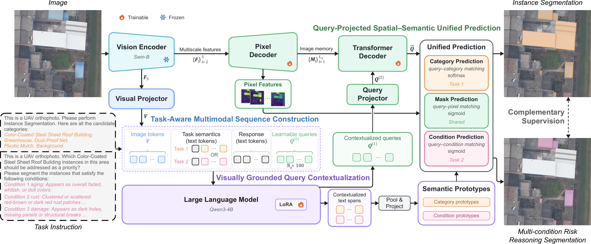
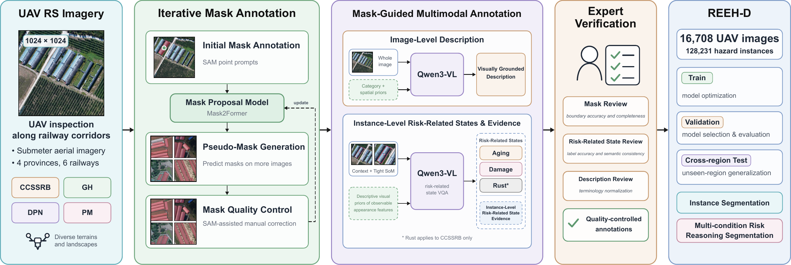

# REEHAA

### 面向无人机遥感影像铁路外部环境隐患分析的实例分割与风险推理统一框架

**Zhihong Li · Qing Zhu · Cheng Liao · Shuo Shi · Jiawei Zhang · Yuhong Jiang**

西南交通大学 · 中铁第一勘察设计院集团有限公司 · 哈尔滨师范大学

**[项目展示页](https://zhihongli98.github.io/REEHAA/) · [Capabilities](https://zhihongli98.github.io/REEHAA/#capabilities) · [代码](REEHAA/) · [数据集](REEH-D/) · [English](README.md)**

REEHAA 统一支持铁路外部环境隐患的实例分割与多条件风险推理分割。

## Overview

## REEH-D 数据集

REEH-D 包含 **16,708 张无人机影像、128,231 个隐患实例**，覆盖四省六条铁路，包含彩钢瓦房、大棚、防尘网和地膜四类隐患。

## Capabilities

[查看 REEHAA 效果](https://zhihongli98.github.io/REEHAA/#capabilities)。

## 开放计划

代码与数据集将在论文录用后公开。
